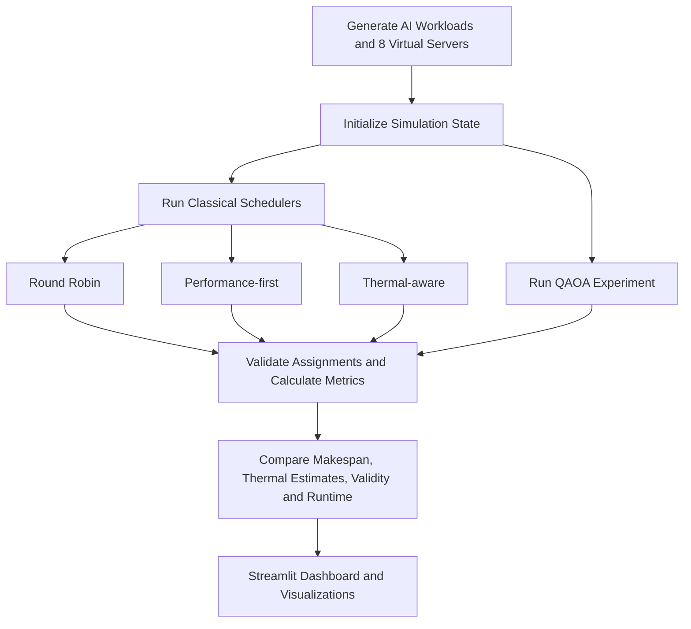

<div align="center">

# Migloo

**VTU-QFF-HC-0187** &nbsp;|&nbsp; Tier: **Online**

</div>

---

<div align="center">

| | |
| :--- | :--- |
| **Team** | Migloo |
| **Team ID** | VTU-QFF-HC-0187 |
| **Tier** | Online |
| **Repository** | [vtu-hc-migloo](https://github.com/vtu-qiskit-fall-fest-2026/vtu-hc-migloo.git) |
| **Organisation** | [vtu-qiskit-fall-fest-2026](https://github.com/vtu-qiskit-fall-fest-2026) |
| **Event** | VTU-QFF Hackathon — VTU-Qiskit Fall Fest 2026 |

</div>

---

## 📌 Table of Contents

- [Team Members](#-team-members-github-ids)
- [Problem Statement](#-problem-statement)
- [Proposed Solution](#-proposed-solution)
- [Approach & Architecture](#-approach--architecture)
- [Tech Stack](#-tech-stack)
- [Project Structure](#-project-structure)
- [How to Run](#-how-to-run)
- [How to Push Code](#-how-to-push-code)
- [Submission Checklist](#-submission-checklist)
- [Resources](#-resources)
- [License](#-license)

---

## 👥 Team Members (GitHub IDs)

> Members are added to this repository as **collaborators** and must accept the
> GitHub invitation before they can push. Add your GitHub username below.

| # | Name | GitHub Username | Role |
| :-- | :--- | :--- | :--- |
| 1 | _Megha M Sekhar_ | _MeghaSekhar_ | _Team Lead_ |
| 2 | _Keerthana S L_ | _keerthanasl1967_ | _Developer_ |
| 3 | _Devika N A_ | _devika-na_ | _Developer_ |

<!--
Optional: add a plain list instead of the table above.
- @username1
- @username2
-->

---

## ❓ Problem Statement

**Problem:** AI workloads running across multiple servers need to be assigned efficiently while considering execution time, server temperature, and workload distribution. Traditional scheduling strategies can prioritize speed or distribute jobs without adequately balancing thermal conditions, making it difficult to compare scheduling trade-offs systematically.

**Why it matters:** Inefficient workload placement can increase processing time and concentrate workloads on particular servers. A simulation-based comparison helps evaluate scheduling strategies under controlled conditions without requiring physical data-center hardware.

**Track / Category:** Online · Quantum Computing / Quantum Optimization

## 💡 Proposed Solution

**Solution:** ThermoRoute Q is an interactive simulation application that models AI workloads across eight virtual servers and compares three classical scheduling algorithms: Round Robin, Performance-first, and Thermal-aware scheduling. It also includes a Quantum Approximate Optimization Algorithm (QAOA) experiment using Qiskit and a local quantum simulator to explore workload assignment for small problem sizes.

**Key idea:** Compare classical scheduling strategies against a QAOA-based optimization experiment using simulated workload, performance, and thermal metrics.

**Why this works:** The application evaluates scheduling strategies under consistent simulated conditions, checks assignment validity, and presents comparative metrics to help users understand trade-offs. The QAOA experiment is an exploratory quantum optimization approach; it does not claim quantum advantage over classical methods.

## 🧩 Approach & Architecture

ThermoRoute Q uses a simulation pipeline that evaluates classical scheduling algorithms and a separate QAOA-based optimization experiment against the same simulated workload model.



1. **Input:** The simulator generates AI jobs and initializes eight virtual servers with defined capacities and simulated thermal states. Sample CSV files can also be validated and previewed by the application.

2. **Simulation:** Workloads are assigned to servers using Round Robin, Performance-first, and Thermal-aware scheduling strategies. Each strategy is evaluated using the simulation model.

3. **Quantum optimization:** The QAOA experiment encodes a small workload-assignment problem into a Qiskit quantum circuit and uses a classical optimizer with a local Qiskit Aer simulator to explore candidate assignments. The experiment is limited to small workloads because the number of qubits grows with the number of job-server assignment variables.

4. **Post-processing:** The application validates assignments and calculates metrics such as makespan, peak simulated temperature, and execution runtime. Results are collected for comparison.

5. **Output:** A Streamlit dashboard presents scheduling results and comparative visualizations to help users examine performance and thermal trade-offs.

**Important limitation:** Temperatures and energy values are simulation estimates, not measurements from physical servers. QAOA runs on a classical simulator, and no quantum speedup or quantum advantage is claimed.</Writing
## 🛠️ Tech Stack

| Layer | Technology |
| :--- | :--- |
| Programming language | Python 3.13 |
| Frontend / Dashboard | Streamlit |
| Data visualization | Plotly |
| Quantum SDK | Qiskit 2.6.0 |
| Quantum simulation | Qiskit Aer 0.18.0 (`AerSimulator`) |
| Quantum optimization | QAOA-based workload assignment with SciPy `minimize` |
| Numerical computing | NumPy, SciPy |
| Testing | Python `unittest` |
| Data handling | Python CSV module |
| Development environment | VS Code, Python virtual environment (`venv`) |
| Version control | Git and GitHub |

**Execution environment:** The QAOA experiment runs locally on a classical simulator. The application models server temperatures and workload behavior; it does not connect to physical servers or quantum hardware.
## 📁 Project Structure

```text
ThermoRoute-Q/
├── app.py
├── simulation.py
├── schedulers.py
├── quantum_optimizer.py
├── metrics.py
├── csv_preview.py
├── requirements.txt
├── experiment_results.csv
├── data/
│   ├── jobs.csv
│   └── servers.csv
├── test_simulation.py
├── test_schedulers.py
├── test_metrics.py
├── test_quantum_optimizer.py
├── test_csv_preview.py
├── README.md
├── LICENSE
└── .gitignore
```

**Key files:**
- `app.py` — Streamlit dashboard and application entry point.
- `simulation.py` — Models virtual servers, AI workloads, and simulation state.
- `schedulers.py` — Implements Round Robin, Performance-first, and Thermal-aware scheduling.
- `quantum_optimizer.py` — Implements the QAOA-based workload assignment experiment using Qiskit Aer.
- `metrics.py` — Validates assignments and calculates comparison metrics.
- `csv_preview.py` — Validates and previews CSV files.
- `data/` — Contains sample job and server datasets.
- `experiment_results.csv` — Stores experiment results.
- `test_*.py` — Unit tests for the project modules.
## 🚀 How to Run

### Prerequisites

- Python 3.11 or newer
- [Git](https://git-scm.com/downloads)
- A code editor such as VS Code

### 1. Clone the repository

```bash
git clone https://github.com/vtu-qiskit-fall-fest-2026/vtu-hc-migloo.git
cd vtu-hc-migloo
```

### 2. Create a virtual environment

**Windows (PowerShell):**

```powershell
python -m venv .venv
.\.venv\Scripts\Activate.ps1
```

**Linux / macOS:**

```bash
python3 -m venv .venv
source .venv/bin/activate
```

### 3. Install dependencies

```bash
python -m pip install --upgrade pip
pip install -r requirements.txt
```

### 4. Launch the application

```bash
streamlit run app.py
```

The Streamlit dashboard will open in your browser. If it does not open automatically, follow the local URL displayed in the terminal.

### 5. Run the tests

```bash
python -m unittest -q
```

The tests verify the simulation, scheduling algorithms, metrics, quantum optimizer, and CSV preview functionality.

---

## 🔁 How to Contribute

ThermoRoute Q is maintained in the VTU-Qiskit Fall Fest 2026 submission repository. Contributors should use branches and pull requests rather than pushing directly to the official repository's `main` branch.

### Configure Git (first time only)

```bash
git config --global user.name "Your Name"
git config --global user.email "you@example.com"
```

Use the name and email associated with your GitHub contributions.

### Everyday workflow

1. Fork the repository on GitHub and clone your fork.
2. Create a branch for your changes.
3. Make your changes and run the tests.
4. Review and commit your changes.
5. Push your branch to your fork.
6. Open a Pull Request against the official repository's `main` branch.

### Commit message convention

| Prefix | Meaning |
|---|---|
| `feat:` | New feature |
| `fix:` | Bug fix |
| `docs:` | Documentation changes |
| `test:` | Adding or fixing tests |
| `refactor:` | Code restructuring without behavior changes |
| `chore:` | Build, configuration, or dependency changes |

### Useful Git commands

```bash
git status
git log --oneline -10
git diff
git stash
```


## Demo Video

Watch our ThermoRoute Q demonstration:

[Watch Demo Video on Google Drive](https://drive.google.com/file/d/12kq7o8JdIU4EFsgqfNEjsMLRJnm0vm5W/view?usp=sharing)


### Collaboration guidelines

- Do not push directly to the official repository's `main` branch.
- Pull or fetch the latest changes before updating your work.
- Use clear commit messages.
- Run the test suite before submitting a Pull Request.
- Review changes carefully and request feedback when possible.
## ✅ Submission Checklist

- [ ] Official submission repository and fork are publicly accessible.
- [ ] Team member details and GitHub usernames are listed under Team Members.
- [ ] `README.md` includes the project overview, problem statement, solution, architecture, and setup instructions.
- [ ] `requirements.txt` contains the project's required dependencies.
- [ ] Application launches successfully using `streamlit run app.py`.
- [ ] All unit tests pass using `python -m unittest -q`.
- [ ] Project code and documentation are pushed to the submission branch.
- [ ] Pull Request is created against the official hackathon repository.
- [ ] Demo screenshot or video link is included, if required by the hackathon.
- [ ] Project summary is submitted through the hackathon portal.
- [ ] Submission is completed before the official deadline.

---
## 📚 Resources

| Resource | Link |
| :--- | :--- |
| ⚛️ Qiskit documentation | [Qiskit Documentation](https://docs.quantum.ibm.com/) |
| 🧪 Qiskit Aer simulator | [Qiskit Aer Documentation](https://qiskit.github.io/qiskit-aer/) |
| 🔬 QAOA algorithm | [Qiskit QAOA Tutorial](https://qiskit-community.github.io/qiskit-algorithms/tutorials/05_qaoa.html) |
| 📊 Streamlit documentation | [Streamlit Documentation](https://docs.streamlit.io/) |
| 📈 Plotly Python | [Plotly Documentation](https://plotly.com/python/) |
| 🐍 Python documentation | [Python Documentation](https://docs.python.org/3/) |
| 🧮 SciPy optimization | [SciPy Optimize Documentation](https://docs.scipy.org/doc/scipy/reference/optimize.html) |
| 🧪 Python unit testing | [Python `unittest`](https://docs.python.org/3/library/unittest.html) |
| 💻 GitHub documentation | [GitHub Docs](https://docs.github.com/) |
## 📄 License

Released under the [MIT License](LICENSE). See `LICENSE` for details.

---

<div align="center">

**ThermoRoute Q** · Team **Migloo** · Team ID `VTU-QFF-HC-0187` · Tier `Online`

*Built with Python, Qiskit, and Streamlit for the VTU-Qiskit Fall Fest 2026 hackathon.*

[⬆ Back to Top](#thermoroute-q)

</div>